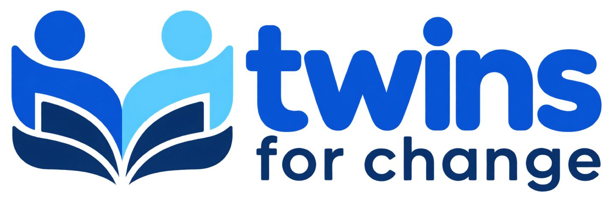
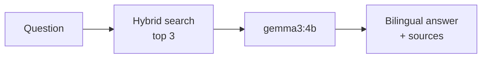

<p align="center">
  
</p>

<p align="center">
  <b>An offline-first AI tutor for bilingual Yorùbá–English classrooms.</b><br/>
  Built for Hack4Edu 2026 · Reto 06 <i>La escuela habla tu idioma</i> · Reto 02 <i>Aprender sin conexión</i>
</p>

<p align="center">
  
  
  
  
  
</p>

---

## Overview

Language models such as Gemma 3 4B often make things up when they answer in Yorùbá. **Twins for Change** grounds every answer in real data: it retrieves verified bilingual examples from a 15,791-row corpus and gives them to Gemma before it answers.

- **Hybrid search**: dense (`bge-m3`) and keyword (BM25) vectors in Qdrant, merged with Reciprocal Rank Fusion
- **Bilingual answers**: explanation in Yorùbá, key terms and summary in English
- **Verified sources**: every answer shows the 3 corpus documents it was based on
- **Compare mode**: plain Gemma and Gemma + RAG side by side on the same question
- **Offline**: after a one-time setup, everything runs on a single laptop



## Getting Started

### Prerequisites

| Tool | Version |
|---|---|
| [uv](https://docs.astral.sh/uv/) | latest |
| [Node.js](https://nodejs.org/) | 22.22.3+ or 24.15+ |
| [Docker](https://www.docker.com/) | latest |
| [Ollama](https://ollama.com/) | latest |

### Installation

```bash
# Dependencies
uv sync
cd site && npm install && cd ..

# Models
ollama pull gemma3:4b
ollama pull bge-m3
```

Create a `.env` file in the repository root:

```env
LLM_MODEL=gemma3:4b
LLM_BASE_URL=http://localhost:11434/v1
LLM_API_KEY=ollama
```

### Usage

With Ollama running, start each service in its own terminal:

```bash
# 1. Vector database
docker run -d --name qdrant -p 6333:6333 -v qdrant_storage:/qdrant/storage qdrant/qdrant:v1.19.1

# 2. Backend  →  http://localhost:8000/docs
uv run uvicorn src.modules.app.main:app --port 8000

# 3. Frontend →  http://localhost:4200
cd site && npx ng serve
```

> [!NOTE]
> The first backend start indexes the full corpus into Qdrant, which can take a while on a CPU. Later starts only connect. To restart the database later, use `docker start qdrant`.

## Dataset

`dataset_rag.csv` is built by `notebooks/creation_dataset_rag.ipynb` from public benchmarks:

| Subject | Source | Rows |
|---|---|---|
| Mathematics | AfriMGSM, GSM8K | 7,731 |
| Sciences and humanities | AfriMMLU | 608 |
| Reading comprehension | Belebele | 900 |
| Translation | MAFAND | 6,552 |

## Project Structure

```
├── src/modules/app/     FastAPI backend and REST API
├── src/modules/rag/     RAG pipeline: storage, retrieval, prompts
├── site/                Angular frontend
├── notebooks/           Dataset creation
├── docs/                Build summary and QA report
└── docker-compose.yml   Production deployment (Qdrant, Ollama, FastAPI, Caddy)
```
